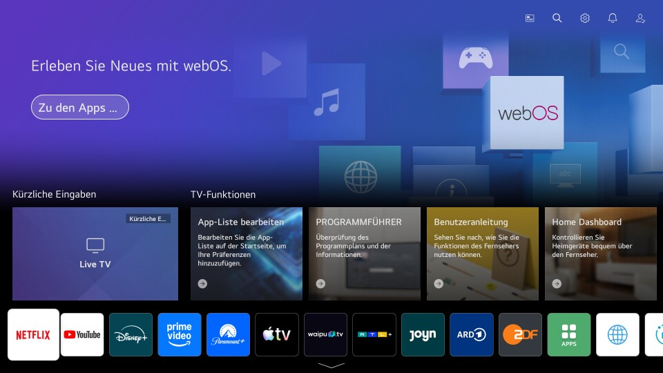
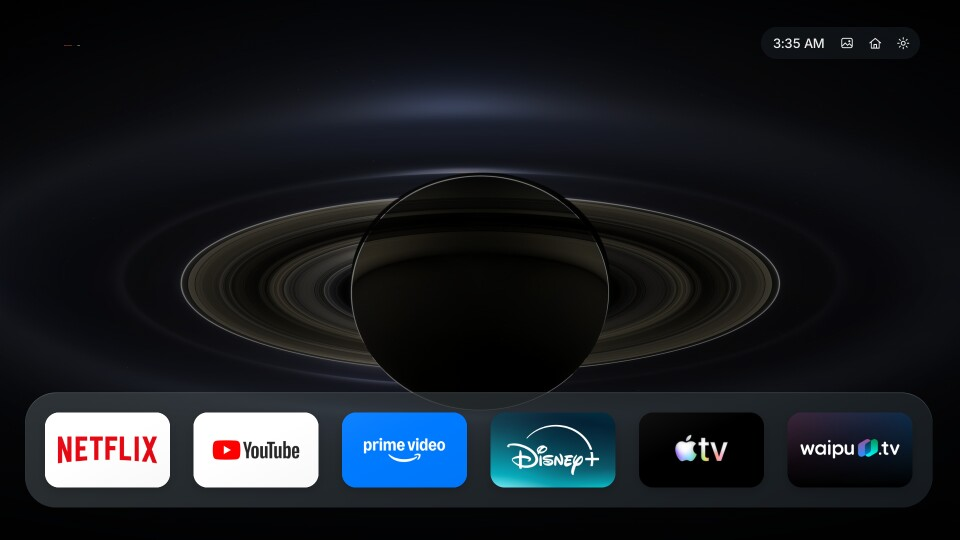

# Quiet Home

A calmer, tvOS-inspired home screen for LG webOS TVs, with your favorite apps, original app icons and rotating space photography.

Created by **Kian Konrad Tajbakhsh**, adapted from [partridgeworks/webos-launcher](https://github.com/partridgeworks/webos-launcher).

**Version 1.3.4 · No root required · Private repository pending review**

## Before and after

### Before: LG Home

LG's standard home screen, with TV feature panels above the app row.



### After: Quiet Home

Your favorite apps in a simple Dock over rotating space imagery.



Both screenshots come from the actual TV test. The **after** image shows Quiet Home 1.3.4. See [compatibility and limits](docs/Compatibility_And_Limits.md) for the tested hardware and verification scope.

## What you get

- **Your apps, your order.** Keep six favorites in the Dock, with other apps and inputs below. Choose what appears and rearrange it with the remote.
- **Original icons.** Use original tvOS provider artwork where available, or the app's original installed-TV icon. The app list refreshes when you return and once a minute while visible, so installed and deleted apps follow along.
- **Dark space backgrounds.** Five real NASA photographs work offline and rotate about once a minute. An optional online refresh updates the collection about every six hours of visible use. Credits stay in Settings, without a photo-source overlay.
- **A clean screen.** App captions stay hidden. Click the background, press Back or leave the window to clear selection; use an arrow key to resume navigation. App names remain available to accessibility tools and as a fallback when artwork is missing.
- **TV-only operation after setup.** Home observation and app discovery run on the TV. You need a computer for installation and updates, but you do not need to leave a Mac running.

## Using the remote

| Action | Control |
| --- | --- |
| Select and open an app | Arrow keys, then OK |
| Reorder apps | Hold OK, move with the arrows, then press OK to place |
| Cancel a move | Back |
| Choose visible apps and inputs | Settings |
| Open the original LG Home screen | House icon |

The first six apps in your saved order become your Dock favorites. You can export and restore your preferences.

## Home button and startup behavior

LG handles the physical Home button first. Quiet Home observes that change and opens its own screen, so **a brief glimpse of LG Home can remain**. Recent TV tests measured about half a second from the Home event to Quiet Home becoming ready; timing varies.

Repeated Home navigation and normal standby/wake passed on the maintainer's LG 2021 A1, webOS SDK 6.5.3 and firmware 03.53.45. **Full startup after unplugging the TV remains unverified.** The app preserves software updates, power management, screensavers and essential LG apps.

LG Developer Mode has a limited session. Extend it through LG's supported control before expiry; disabling or expiring Developer Mode can remove developer-installed apps.

## Build and install

### 1. Prepare your setup computer

Use **Node.js 20+** and **Python 3.9+**. The TV service targets the TV's separate Node 8.12 runtime.

From this repository's folder:

```sh
npm ci --ignore-scripts
npm run service:deps
python3 -m venv .venv
. .venv/bin/activate
python -m pip install --no-deps -r tools/requirements.txt
npm run registration:generate
```

### 2. Fetch optional original app artwork

For your private installation, you can download the reviewed original provider icons:

```sh
npm run assets:fetch
```

You can skip this step and use native TV artwork instead. Provider icon files are excluded from this repository; see [artwork and credits](#artwork-and-credits).

### 3. Build the TV package

```sh
npm run build
npm run package
```

Output: `build/org.quiethome.launcher_1.3.4_all.ipk`.

### 4. Install and pair with your TV

Follow the [step-by-step installation and recovery guide](docs/Installation_And_Recovery.md) to enable LG Developer Mode, register your TV with the official CLI, install the package and approve pairing on the TV. Keep keys and preference backups outside the repository.

This source uses the generic app ID `org.quiethome.launcher`. It builds and packages locally, but has not been installed on another TV. It is a separate package from the maintainer's private TV installation, so it will not update that installation in place.

## Updates, recovery and technical details

| Guide | Covers |
| --- | --- |
| [Installation and recovery](docs/Installation_And_Recovery.md) | Setup, pairing, preference backup, verified stopping, updates and removal |
| [Maintenance](docs/Maintenance.md) | Day-to-day maintenance and source hygiene |
| [Compatibility and limits](docs/Compatibility_And_Limits.md) | Tested platform, Home behavior, startup and remaining verification limits |
| [Security](SECURITY.md) | Pairing, private state and local network precautions |
| [Dependency audit](docs/Dependency_Audit.md) | Remaining development-tool advisories |

## Artwork and credits

Quiet Home's adaptation code uses the [MIT license](LICENSE), with [upstream attribution](ATTRIBUTION.md) retained. Fonts, photographs and provider artwork keep their own terms; see [third-party notices](THIRD_PARTY_NOTICES.md).

- **App icons:** optional downloads use original publisher artwork. The fetcher checks the reviewed PNG rendering/color data and keeps downloaded bytes unchanged. Changed image content stops the download. Apple TV and GeForce NOW use their original installed-TV artwork. Public availability does not grant redistribution rights; provider icons are not covered by this project's MIT license.
- **Space photography:** the five bundled images are real NASA observations or photography. Exact sources and credits appear in the [image manifest](public/licenses/Space_Photo_Sources.json) and Settings.
- **Screenshots:** the comparison uses genuine TV captures converted to metadata-free PNG. Visible LG/provider artwork remains owned by its respective publishers.

This independent project has no sponsorship or endorsement from LG, Apple, NASA or the app providers. The repository remains private until Kian reviews it for publication.
